# Diagramas BPMN

Diagramas generados automáticamente desde los ficheros `.bpmn` del repositorio.

## 01-business-processes/ecommerce

### approve\_document

[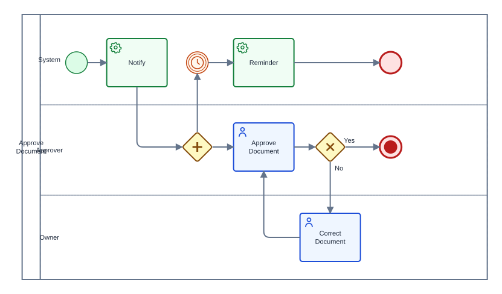](01-business-processes/ecommerce/approve_document.bpmn)

Fuente: [`01-business-processes/ecommerce/approve_document.bpmn`](01-business-processes/ecommerce/approve_document.bpmn)

### control-antifraude

Fuente: [`01-business-processes/ecommerce/control-antifraude.bpmn`](01-business-processes/ecommerce/control-antifraude.bpmn)

### notify

[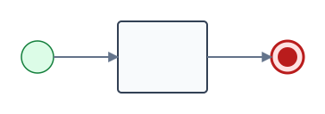](01-business-processes/ecommerce/notify.bpmn)

Fuente: [`01-business-processes/ecommerce/notify.bpmn`](01-business-processes/ecommerce/notify.bpmn)

### pago-global

[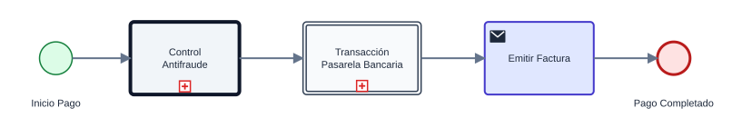](01-business-processes/ecommerce/pago-global.bpmn)

Fuente: [`01-business-processes/ecommerce/pago-global.bpmn`](01-business-processes/ecommerce/pago-global.bpmn)

### pedido-principal

Fuente: [`01-business-processes/ecommerce/pedido-principal.bpmn`](01-business-processes/ecommerce/pedido-principal.bpmn)

## 01-business-processes/initiatives

### AdmitirIniciativa-v2

Fuente: [`01-business-processes/initiatives/AdmitirIniciativa-v2.bpmn`](01-business-processes/initiatives/AdmitirIniciativa-v2.bpmn)

### AdmitirIniciativa

[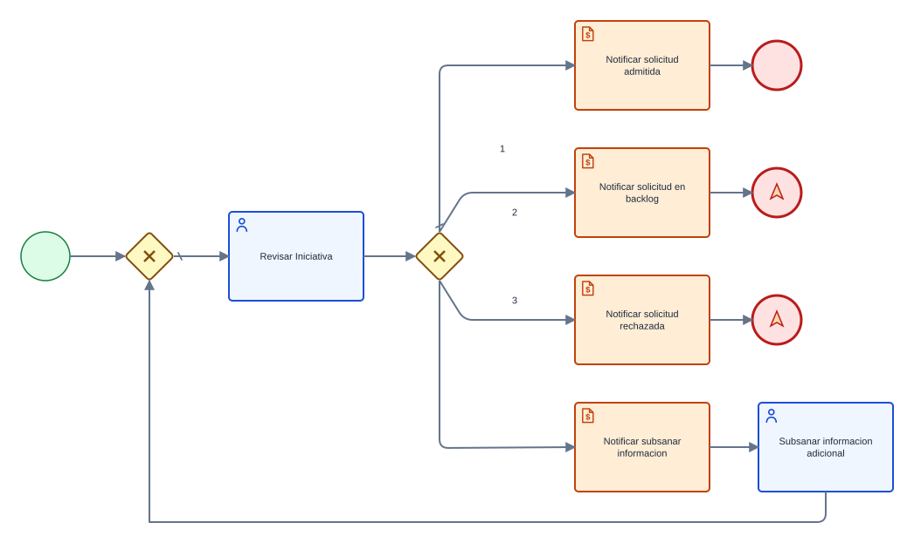](01-business-processes/initiatives/AdmitirIniciativa.bpmn)

Fuente: [`01-business-processes/initiatives/AdmitirIniciativa.bpmn`](01-business-processes/initiatives/AdmitirIniciativa.bpmn)

### GestionDeIniciativas

Fuente: [`01-business-processes/initiatives/GestionDeIniciativas.bpmn`](01-business-processes/initiatives/GestionDeIniciativas.bpmn)

### RealizarDesarrollo

Fuente: [`01-business-processes/initiatives/RealizarDesarrollo.bpmn`](01-business-processes/initiatives/RealizarDesarrollo.bpmn)

### RegistrarIniciativa

[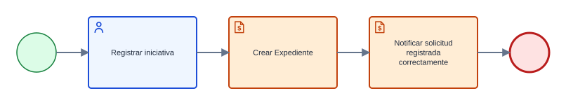](01-business-processes/initiatives/RegistrarIniciativa.bpmn)

Fuente: [`01-business-processes/initiatives/RegistrarIniciativa.bpmn`](01-business-processes/initiatives/RegistrarIniciativa.bpmn)

## 01-business-processes/nexa

### 100\_Request Management Process

Fuente: [`01-business-processes/nexa/100_Request Management Process.bpmn`](01-business-processes/nexa/100_Request%20Management%20Process.bpmn)

### Error Handle Process

Fuente: [`01-business-processes/nexa/Error Handle Process.bpmn`](01-business-processes/nexa/Error%20Handle%20Process.bpmn)

### Request Management Process

Fuente: [`01-business-processes/nexa/Request Management Process.bpmn`](01-business-processes/nexa/Request%20Management%20Process.bpmn)

### Start Process

Fuente: [`01-business-processes/nexa/Start Process.bpmn`](01-business-processes/nexa/Start%20Process.bpmn)

## 01-business-processes/nexa/op

### process-aval

[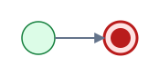](01-business-processes/nexa/op/process-aval.bpmn)

Fuente: [`01-business-processes/nexa/op/process-aval.bpmn`](01-business-processes/nexa/op/process-aval.bpmn)

### process-confirming

Fuente: [`01-business-processes/nexa/op/process-confirming.bpmn`](01-business-processes/nexa/op/process-confirming.bpmn)

### process-renting

Fuente: [`01-business-processes/nexa/op/process-renting.bpmn`](01-business-processes/nexa/op/process-renting.bpmn)

## 01-business-processes/requests

### diagram\_1

[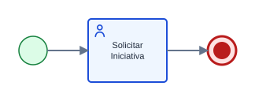](01-business-processes/requests/diagram_1.bpmn)

Fuente: [`01-business-processes/requests/diagram_1.bpmn`](01-business-processes/requests/diagram_1.bpmn)

### puro

[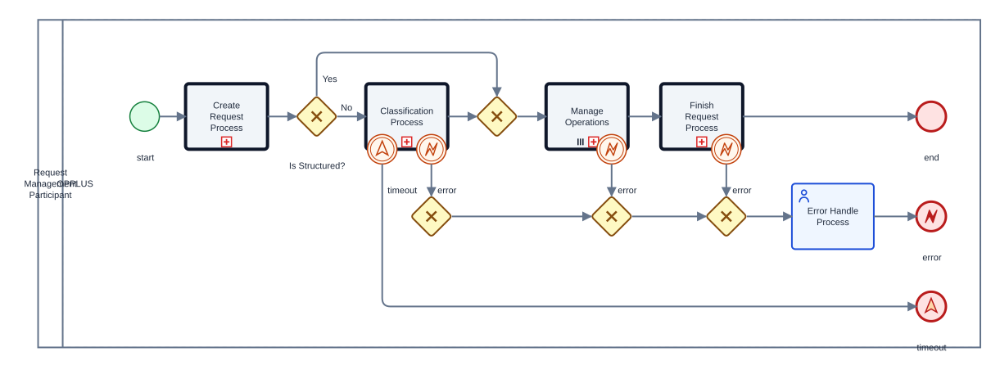](01-business-processes/requests/puro.bpmn)

Fuente: [`01-business-processes/requests/puro.bpmn`](01-business-processes/requests/puro.bpmn)

## 02-operations

### 100\_Request Management Process

Fuente: [`02-operations/100_Request Management Process.bpmn`](02-operations/100_Request%20Management%20Process.bpmn)

### 110\_Create Request Process

Fuente: [`02-operations/110_Create Request Process.bpmn`](02-operations/110_Create%20Request%20Process.bpmn)

### 120\_Classification Process

Fuente: [`02-operations/120_Classification Process.bpmn`](02-operations/120_Classification%20Process.bpmn)

### 130\_Operation Management Process

Fuente: [`02-operations/130_Operation Management Process.bpmn`](02-operations/130_Operation%20Management%20Process.bpmn)

### 131\_Create Operation Process

Fuente: [`02-operations/131_Create Operation Process.bpmn`](02-operations/131_Create%20Operation%20Process.bpmn)

### 133\_Create Business Process

Fuente: [`02-operations/133_Create Business Process.bpmn`](02-operations/133_Create%20Business%20Process.bpmn)

### 134\_Finish Operation Process

Fuente: [`02-operations/134_Finish Operation Process.bpmn`](02-operations/134_Finish%20Operation%20Process.bpmn)

### 140\_Finish Request Process

Fuente: [`02-operations/140_Finish Request Process.bpmn`](02-operations/140_Finish%20Request%20Process.bpmn)

## 02-operations/agentic

### 000\_Subproceso\_Agentico

[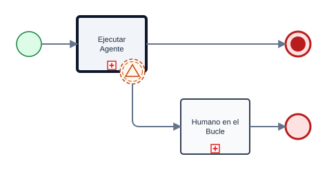](02-operations/agentic/000_Subproceso_Agentico.bpmn)

Fuente: [`02-operations/agentic/000_Subproceso_Agentico.bpmn`](02-operations/agentic/000_Subproceso_Agentico.bpmn)

## 03-utils/communications

### Notify

Fuente: [`03-utils/communications/Notify.bpmn`](03-utils/communications/Notify.bpmn)

## 03-utils/communications/email

### Send email

Fuente: [`03-utils/communications/email/Send email.bpmn`](03-utils/communications/email/Send%20email.bpmn)

## 03-utils/documents/Review

### Process - Review documentation

Fuente: [`03-utils/documents/Review/Process - Review documentation.bpmn`](03-utils/documents/Review/Process%20-%20Review%20documentation.bpmn)

## 03-utils/errors

### ManageTechnicalError

[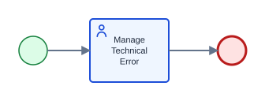](03-utils/errors/ManageTechnicalError.bpmn)

Fuente: [`03-utils/errors/ManageTechnicalError.bpmn`](03-utils/errors/ManageTechnicalError.bpmn)

## 04-agents

### agent

[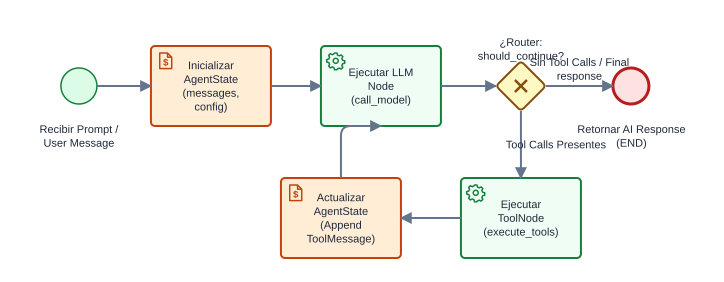](04-agents/agent.bpmn)

Fuente: [`04-agents/agent.bpmn`](04-agents/agent.bpmn)

## 99-examples

### Agent Orchestration Demo

Fuente: [`99-examples/Agent Orchestration Demo.bpmn`](99-examples/Agent%20Orchestration%20Demo.bpmn)

### Ejemplo\_complejo

Fuente: [`99-examples/Ejemplo_complejo.bpmn`](99-examples/Ejemplo_complejo.bpmn)

### Proceso clasico-v2

Fuente: [`99-examples/Proceso clasico-v2.bpmn`](99-examples/Proceso%20clasico-v2.bpmn)

### Proceso clasico

Fuente: [`99-examples/Proceso clasico.bpmn`](99-examples/Proceso%20clasico.bpmn)

### Proceso de Prueba de Incidentes

Fuente: [`99-examples/Proceso de Prueba de Incidentes.bpmn`](99-examples/Proceso%20de%20Prueba%20de%20Incidentes.bpmn)

### Proceso de peticion

Fuente: [`99-examples/Proceso de peticion.bpmn`](99-examples/Proceso%20de%20peticion.bpmn)

### Proceso1

[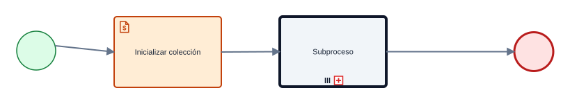](99-examples/Proceso1.bpmn)

Fuente: [`99-examples/Proceso1.bpmn`](99-examples/Proceso1.bpmn)

### Process - Dummy-v2

Fuente: [`99-examples/Process - Dummy-v2.bpmn`](99-examples/Process%20-%20Dummy-v2.bpmn)

### Process - Dummy

Fuente: [`99-examples/Process - Dummy.bpmn`](99-examples/Process%20-%20Dummy.bpmn)

### Request Management Process

Fuente: [`99-examples/Request Management Process.bpmn`](99-examples/Request%20Management%20Process.bpmn)

### Revisión documentación eficiencia energetica vehiculos

Fuente: [`99-examples/Revisión documentación eficiencia energetica vehiculos.bpmn`](99-examples/Revisi%C3%B3n%20documentaci%C3%B3n%20eficiencia%20energetica%20vehiculos.bpmn)

### SendMailTest

Fuente: [`99-examples/SendMailTest.bpmn`](99-examples/SendMailTest.bpmn)

### SimpleHumanTaskProcess

Fuente: [`99-examples/SimpleHumanTaskProcess.bpmn`](99-examples/SimpleHumanTaskProcess.bpmn)

### Subproceso

Fuente: [`99-examples/Subproceso.bpmn`](99-examples/Subproceso.bpmn)

### Subproceso\_evento

[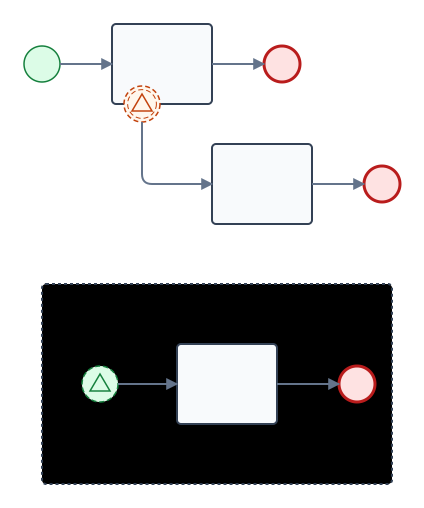](99-examples/Subproceso_evento.bpmn)

Fuente: [`99-examples/Subproceso_evento.bpmn`](99-examples/Subproceso_evento.bpmn)

### bancos\_representados

Fuente: [`99-examples/bancos_representados.bpmn`](99-examples/bancos_representados.bpmn)

### bpmn\_exhaustive\_v2

Fuente: [`99-examples/bpmn_exhaustive_v2.bpmn`](99-examples/bpmn_exhaustive_v2.bpmn)

### diagram-v2

[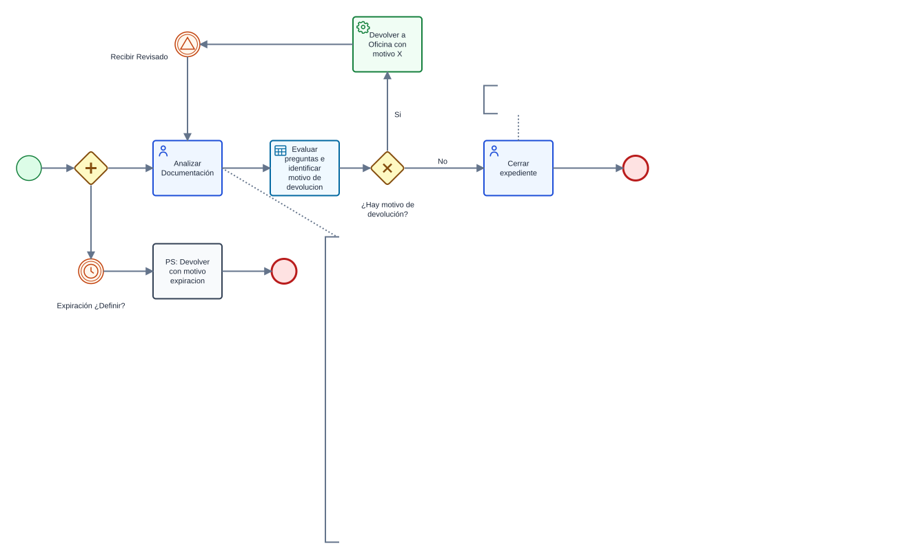](99-examples/diagram-v2.bpmn)

Fuente: [`99-examples/diagram-v2.bpmn`](99-examples/diagram-v2.bpmn)

### diagram-v3

[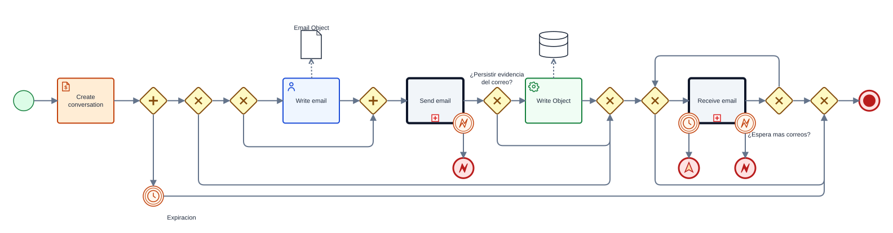](99-examples/diagram-v3.bpmn)

Fuente: [`99-examples/diagram-v3.bpmn`](99-examples/diagram-v3.bpmn)

### diagram-v4

[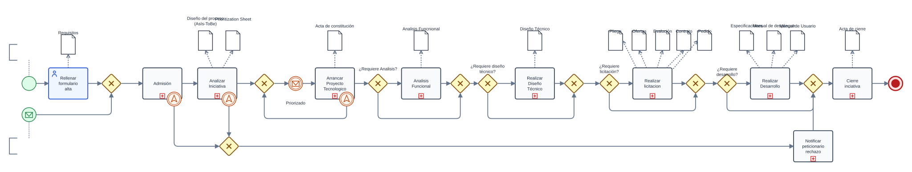](99-examples/diagram-v4.bpmn)

Fuente: [`99-examples/diagram-v4.bpmn`](99-examples/diagram-v4.bpmn)

### diagram

Fuente: [`99-examples/diagram.bpmn`](99-examples/diagram.bpmn)

### diagram\_1

[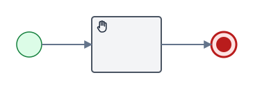](99-examples/diagram_1.bpmn)

Fuente: [`99-examples/diagram_1.bpmn`](99-examples/diagram_1.bpmn)

## 99-examples/camunda-kie

### Manage Software Project Request-v2

Fuente: [`99-examples/camunda-kie/Manage Software Project Request-v2.bpmn`](99-examples/camunda-kie/Manage%20Software%20Project%20Request-v2.bpmn)

### Manage Software Project Request

Fuente: [`99-examples/camunda-kie/Manage Software Project Request.bpmn`](99-examples/camunda-kie/Manage%20Software%20Project%20Request.bpmn)

### Process - Manage Software Project Request-v2

Fuente: [`99-examples/camunda-kie/Process - Manage Software Project Request-v2.bpmn`](99-examples/camunda-kie/Process%20-%20Manage%20Software%20Project%20Request-v2.bpmn)

### Process - Manage Software Project Request

Fuente: [`99-examples/camunda-kie/Process - Manage Software Project Request.bpmn`](99-examples/camunda-kie/Process%20-%20Manage%20Software%20Project%20Request.bpmn)

### exported-camunda

[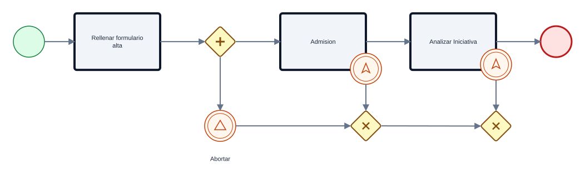](99-examples/camunda-kie/exported-camunda.bpmn)

Fuente: [`99-examples/camunda-kie/exported-camunda.bpmn`](99-examples/camunda-kie/exported-camunda.bpmn)

### exported-kie

[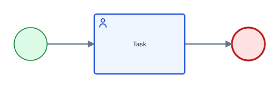](99-examples/camunda-kie/exported-kie.bpmn)

Fuente: [`99-examples/camunda-kie/exported-kie.bpmn`](99-examples/camunda-kie/exported-kie.bpmn)
