# Diagramas BPMN

Diagramas generados automáticamente desde los ficheros `.bpmn` del repositorio.

## approve\_document

Fuente: [`approve_document.bpmn`](approve_document.bpmn)

## control-antifraude

[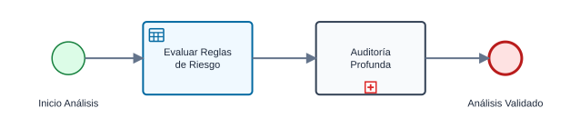](control-antifraude.bpmn)

Fuente: [`control-antifraude.bpmn`](control-antifraude.bpmn)

## diagram\_1

Fuente: [`diagram_1.bpmn`](diagram_1.bpmn)

## GestionDeIniciativas

[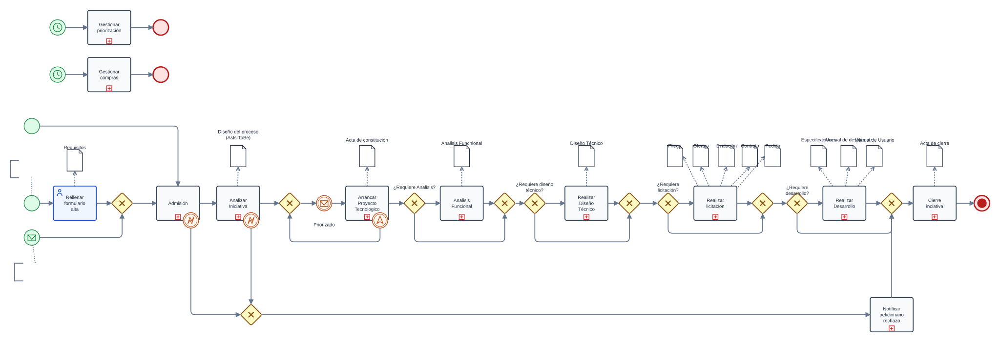](GestionDeIniciativas.bpmn)

Fuente: [`GestionDeIniciativas.bpmn`](GestionDeIniciativas.bpmn)

## notify

Fuente: [`notify.bpmn`](notify.bpmn)

## pago-global

Fuente: [`pago-global.bpmn`](pago-global.bpmn)

## pedido-principal

[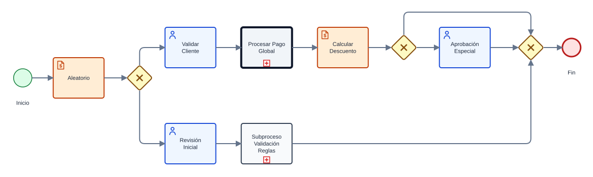](pedido-principal.bpmn)

Fuente: [`pedido-principal.bpmn`](pedido-principal.bpmn)

## diagrams

### bpmn\_exhaustive\_v2

[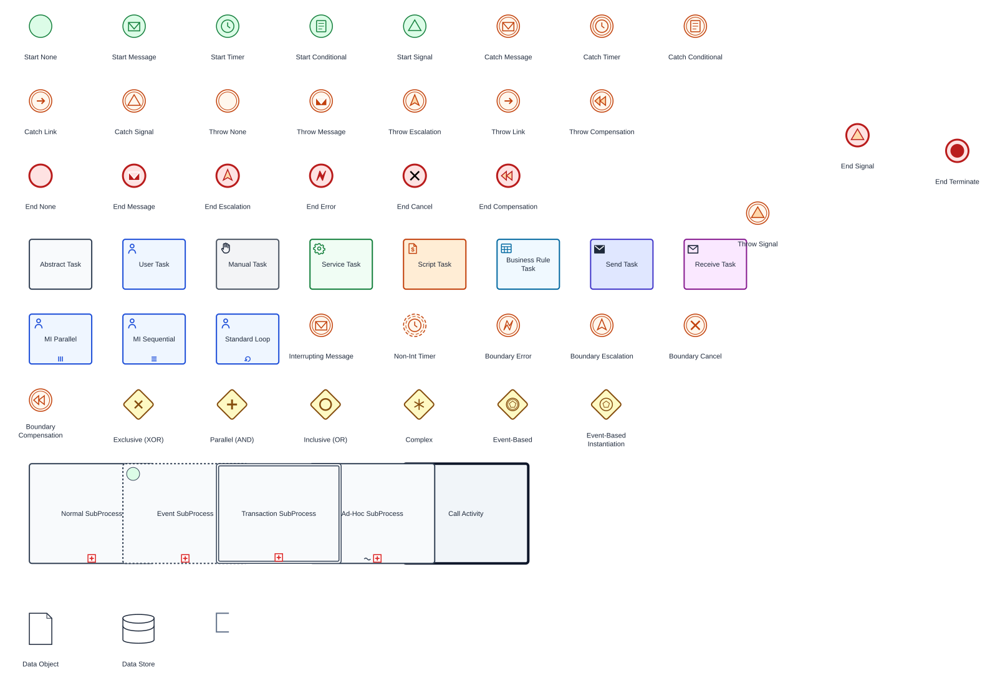](diagrams/bpmn_exhaustive_v2.bpmn)

Fuente: [`diagrams/bpmn_exhaustive_v2.bpmn`](diagrams/bpmn_exhaustive_v2.bpmn)

## diagrams/Business Processes

### puro

Fuente: [`diagrams/Business Processes/puro.bpmn`](diagrams/Business%20Processes/puro.bpmn)

## diagrams/Business Processes/Nexa

### 000\_Subproceso\_Agentico

Fuente: [`diagrams/Business Processes/Nexa/000_Subproceso_Agentico.bpmn`](diagrams/Business%20Processes/Nexa/000_Subproceso_Agentico.bpmn)

### Error Handle Process

Fuente: [`diagrams/Business Processes/Nexa/Error Handle Process.bpmn`](diagrams/Business%20Processes/Nexa/Error%20Handle%20Process.bpmn)

### Request Management Process

Fuente: [`diagrams/Business Processes/Nexa/Request Management Process.bpmn`](diagrams/Business%20Processes/Nexa/Request%20Management%20Process.bpmn)

### Start Process

Fuente: [`diagrams/Business Processes/Nexa/Start Process.bpmn`](diagrams/Business%20Processes/Nexa/Start%20Process.bpmn)

## diagrams/Business Processes/Nexa/op

### process-aval

Fuente: [`diagrams/Business Processes/Nexa/op/process-aval.bpmn`](diagrams/Business%20Processes/Nexa/op/process-aval.bpmn)

### process-confirming

Fuente: [`diagrams/Business Processes/Nexa/op/process-confirming.bpmn`](diagrams/Business%20Processes/Nexa/op/process-confirming.bpmn)

### process-renting

Fuente: [`diagrams/Business Processes/Nexa/op/process-renting.bpmn`](diagrams/Business%20Processes/Nexa/op/process-renting.bpmn)

## diagrams/Otros

### AdmitirIniciativa

Fuente: [`diagrams/Otros/AdmitirIniciativa.bpmn`](diagrams/Otros/AdmitirIniciativa.bpmn)

### AdmitirIniciativa (1)

[.svg)](diagrams/Otros/AdmitirIniciativa%20(1).bpmn)

Fuente: [`diagrams/Otros/AdmitirIniciativa (1).bpmn`](diagrams/Otros/AdmitirIniciativa%20(1).bpmn)

### Agent Orchestration Demo

Fuente: [`diagrams/Otros/Agent Orchestration Demo.bpmn`](diagrams/Otros/Agent%20Orchestration%20Demo.bpmn)

### bancos\_representados

[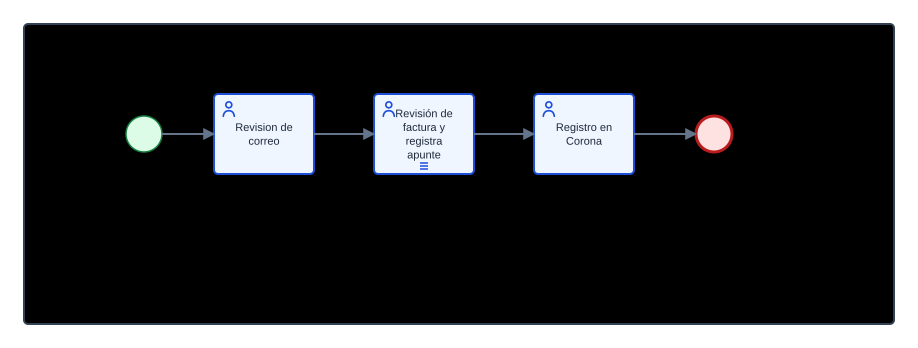](diagrams/Otros/bancos_representados.bpmn)

Fuente: [`diagrams/Otros/bancos_representados.bpmn`](diagrams/Otros/bancos_representados.bpmn)

### diagram

[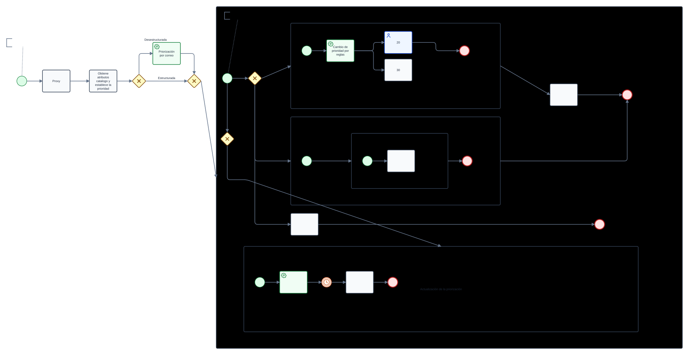](diagrams/Otros/diagram.bpmn)

Fuente: [`diagrams/Otros/diagram.bpmn`](diagrams/Otros/diagram.bpmn)

### diagram (1)

[.svg)](diagrams/Otros/diagram%20(1).bpmn)

Fuente: [`diagrams/Otros/diagram (1).bpmn`](diagrams/Otros/diagram%20(1).bpmn)

### diagram (2)

[.svg)](diagrams/Otros/diagram%20(2).bpmn)

Fuente: [`diagrams/Otros/diagram (2).bpmn`](diagrams/Otros/diagram%20(2).bpmn)

### diagram (3)

[.svg)](diagrams/Otros/diagram%20(3).bpmn)

Fuente: [`diagrams/Otros/diagram (3).bpmn`](diagrams/Otros/diagram%20(3).bpmn)

### diagram\_1

Fuente: [`diagrams/Otros/diagram_1.bpmn`](diagrams/Otros/diagram_1.bpmn)

### Ejemplo\_complejo

Fuente: [`diagrams/Otros/Ejemplo_complejo.bpmn`](diagrams/Otros/Ejemplo_complejo.bpmn)

### exported-camunda

Fuente: [`diagrams/Otros/exported-camunda.bpmn`](diagrams/Otros/exported-camunda.bpmn)

### exported-kie

Fuente: [`diagrams/Otros/exported-kie.bpmn`](diagrams/Otros/exported-kie.bpmn)

### Manage Software Project Request

Fuente: [`diagrams/Otros/Manage Software Project Request.bpmn`](diagrams/Otros/Manage%20Software%20Project%20Request.bpmn)

### Manage Software Project Request (1)

[.svg)](diagrams/Otros/Manage%20Software%20Project%20Request%20(1).bpmn)

Fuente: [`diagrams/Otros/Manage Software Project Request (1).bpmn`](diagrams/Otros/Manage%20Software%20Project%20Request%20(1).bpmn)

### Proceso clasico

Fuente: [`diagrams/Otros/Proceso clasico.bpmn`](diagrams/Otros/Proceso%20clasico.bpmn)

### Proceso clasico (1)

[.svg)](diagrams/Otros/Proceso%20clasico%20(1).bpmn)

Fuente: [`diagrams/Otros/Proceso clasico (1).bpmn`](diagrams/Otros/Proceso%20clasico%20(1).bpmn)

### Proceso de peticion

Fuente: [`diagrams/Otros/Proceso de peticion.bpmn`](diagrams/Otros/Proceso%20de%20peticion.bpmn)

### Proceso de Prueba de Incidentes

Fuente: [`diagrams/Otros/Proceso de Prueba de Incidentes.bpmn`](diagrams/Otros/Proceso%20de%20Prueba%20de%20Incidentes.bpmn)

### Proceso1

Fuente: [`diagrams/Otros/Proceso1.bpmn`](diagrams/Otros/Proceso1.bpmn)

### Process - Dummy

Fuente: [`diagrams/Otros/Process - Dummy.bpmn`](diagrams/Otros/Process%20-%20Dummy.bpmn)

### Process - Dummy (1)

[.svg)](diagrams/Otros/Process%20-%20Dummy%20(1).bpmn)

Fuente: [`diagrams/Otros/Process - Dummy (1).bpmn`](diagrams/Otros/Process%20-%20Dummy%20(1).bpmn)

### Process - Manage Software Project Request

Fuente: [`diagrams/Otros/Process - Manage Software Project Request.bpmn`](diagrams/Otros/Process%20-%20Manage%20Software%20Project%20Request.bpmn)

### Process - Manage Software Project Request (1)

[.svg)](diagrams/Otros/Process%20-%20Manage%20Software%20Project%20Request%20(1).bpmn)

Fuente: [`diagrams/Otros/Process - Manage Software Project Request (1).bpmn`](diagrams/Otros/Process%20-%20Manage%20Software%20Project%20Request%20(1).bpmn)

### RealizarDesarrollo

[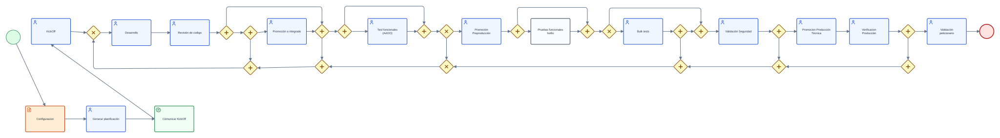](diagrams/Otros/RealizarDesarrollo.bpmn)

Fuente: [`diagrams/Otros/RealizarDesarrollo.bpmn`](diagrams/Otros/RealizarDesarrollo.bpmn)

### RegistrarIniciativa

Fuente: [`diagrams/Otros/RegistrarIniciativa.bpmn`](diagrams/Otros/RegistrarIniciativa.bpmn)

### Request Management Process

Fuente: [`diagrams/Otros/Request Management Process.bpmn`](diagrams/Otros/Request%20Management%20Process.bpmn)

### Revisión documentación eficiencia energetica vehiculos

Fuente: [`diagrams/Otros/Revisión documentación eficiencia energetica vehiculos.bpmn`](diagrams/Otros/Revisi%C3%B3n%20documentaci%C3%B3n%20eficiencia%20energetica%20vehiculos.bpmn)

### SendMailTest

[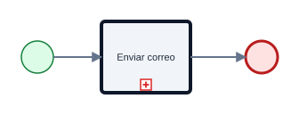](diagrams/Otros/SendMailTest.bpmn)

Fuente: [`diagrams/Otros/SendMailTest.bpmn`](diagrams/Otros/SendMailTest.bpmn)

### SimpleHumanTaskProcess

[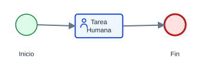](diagrams/Otros/SimpleHumanTaskProcess.bpmn)

Fuente: [`diagrams/Otros/SimpleHumanTaskProcess.bpmn`](diagrams/Otros/SimpleHumanTaskProcess.bpmn)

### Subproceso

[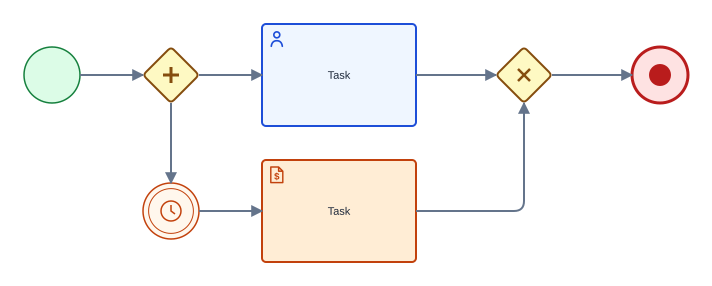](diagrams/Otros/Subproceso.bpmn)

Fuente: [`diagrams/Otros/Subproceso.bpmn`](diagrams/Otros/Subproceso.bpmn)

### Subproceso\_evento

Fuente: [`diagrams/Otros/Subproceso_evento.bpmn`](diagrams/Otros/Subproceso_evento.bpmn)

## operations

### 100\_Request Management Process

Fuente: [`operations/100_Request Management Process.bpmn`](operations/100_Request%20Management%20Process.bpmn)

### 110\_Create Request Process

Fuente: [`operations/110_Create Request Process.bpmn`](operations/110_Create%20Request%20Process.bpmn)

### 120\_Classification Process

Fuente: [`operations/120_Classification Process.bpmn`](operations/120_Classification%20Process.bpmn)

### 130\_Operation Management Process

Fuente: [`operations/130_Operation Management Process.bpmn`](operations/130_Operation%20Management%20Process.bpmn)

### 131\_Create Operation Process

Fuente: [`operations/131_Create Operation Process.bpmn`](operations/131_Create%20Operation%20Process.bpmn)

### 133\_Create Business Process

Fuente: [`operations/133_Create Business Process.bpmn`](operations/133_Create%20Business%20Process.bpmn)

### 134\_Finish Operation Process

Fuente: [`operations/134_Finish Operation Process.bpmn`](operations/134_Finish%20Operation%20Process.bpmn)

### 140\_Finish Request Process

Fuente: [`operations/140_Finish Request Process.bpmn`](operations/140_Finish%20Request%20Process.bpmn)

## utils/Communications

### Notify

[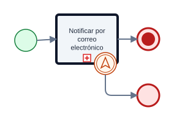](utils/Communications/Notify.bpmn)

Fuente: [`utils/Communications/Notify.bpmn`](utils/Communications/Notify.bpmn)

## utils/Communications/email

### Send email

Fuente: [`utils/Communications/email/Send email.bpmn`](utils/Communications/email/Send%20email.bpmn)

## utils/Documents/Review

### Process - Review documentation

Fuente: [`utils/Documents/Review/Process - Review documentation.bpmn`](utils/Documents/Review/Process%20-%20Review%20documentation.bpmn)

## utils/Errors

### ManageTechnicalError

Fuente: [`utils/Errors/ManageTechnicalError.bpmn`](utils/Errors/ManageTechnicalError.bpmn)
